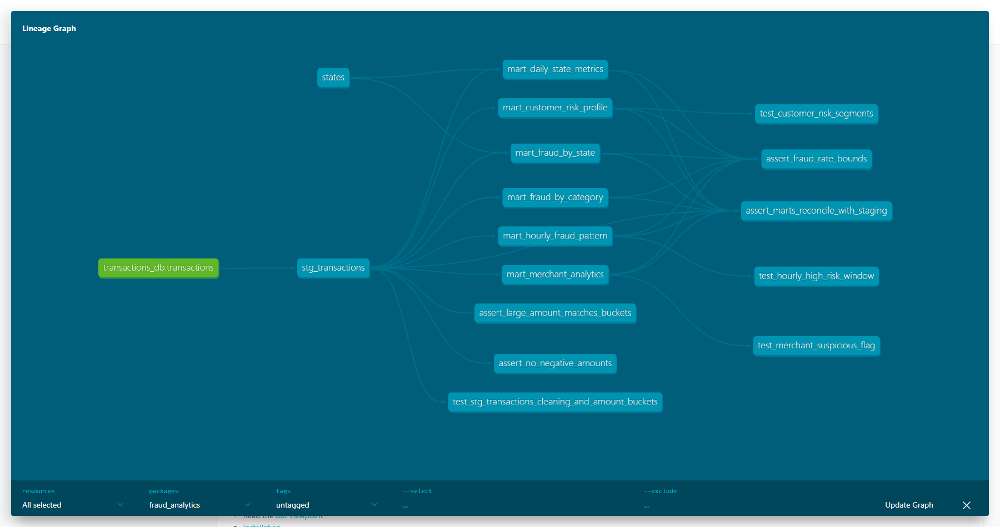
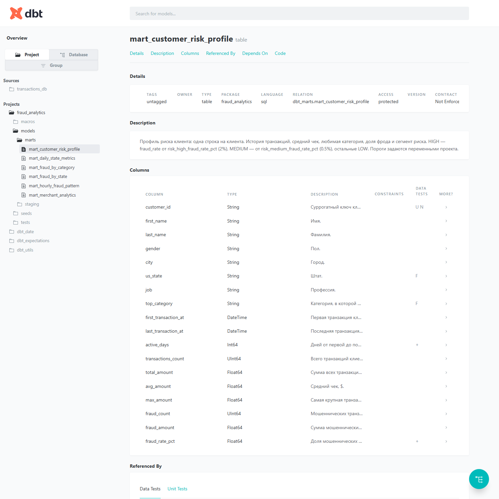

# ДЗ №4: Введение в dbt

dbt-проект поверх ClickHouse на датасете транзакций из ДЗ №2 (`train.csv`, 786 431 строка,
2019-01-01 — 2020-03-10). Сырые данные проходят staging-слой и раскладываются в шесть
аналитических витрин по фроду. 114 тестов (generic, singular, unit) зелёные, SQL проверяется
sqlfluff в pre-commit.

```
transactions_db.transactions ──► stg_transactions ──┬──► mart_daily_state_metrics   ◄── states (seed)
        (source, ClickHouse)       (view, staging)  ├──► mart_fraud_by_category
                                                    ├──► mart_fraud_by_state        ◄── states (seed)
                                                    ├──► mart_customer_risk_profile
                                                    ├──► mart_hourly_fraud_pattern
                                                    └──► mart_merchant_analytics
```



## Версии

| Компонент | Версия |
|---|---|
| dbt-core | 1.12.6 |
| dbt-clickhouse | 1.10.3 |
| ClickHouse | 24.8 |
| dbt_utils / dbt_date / dbt_expectations | 1.4.1 / 0.21.0 / 0.10.10 (metaplane) |
| sqlfluff + sqlfluff-templater-dbt | 3.5.0 |

## Структура

| Путь | Что это |
|---|---|
| [docker-compose.yml](docker-compose.yml) | ClickHouse 24.8 |
| [clickhouse/01_source_ddl.sql](clickhouse/01_source_ddl.sql) | База `transactions_db` и таблица-источник, создаются при первом старте |
| [clickhouse/02_load.sql](clickhouse/02_load.sql) | Загрузка `data/train.csv` (идемпотентно: TRUNCATE + INSERT) |
| [dbt/dbt_project.yml](dbt/dbt_project.yml) | Слои, материализации, бизнес-пороги в `vars`, dispatch для dbt_expectations |
| [dbt/profiles.yml](dbt/profiles.yml) | Подключение к ClickHouse, параметры переопределяются `CLICKHOUSE_*` |
| [dbt/packages.yml](dbt/packages.yml) | dbt_utils, dbt_date, dbt_expectations |
| [dbt/models/sources/](dbt/models/sources/sources.yml) | Описание источника и тесты на сырые данные |
| [dbt/models/staging/](dbt/models/staging/) | `stg_transactions`, его описание, тесты и unit-тест |
| [dbt/models/marts/](dbt/models/marts/) | Шесть витрин, `schema.yml`, unit-тесты |
| [dbt/macros/](dbt/macros/) | Собственные макросы |
| [dbt/tests/](dbt/tests/) | Singular-тесты |
| [dbt/seeds/states.csv](dbt/seeds/states.csv) | Справочник штатов: название, регион, подрайон |
| [.sqlfluff](.sqlfluff), [.pre-commit-config.yaml](.pre-commit-config.yaml), [Makefile](Makefile) | Линтинг, хуки, команды |
| [docs/](docs/) | Скриншоты dbt Docs, логи `dbt build` и `dbt test` |

## Запуск

Нужны Docker, Python 3.10+ и `make` (на Windows подойдёт `mingw32-make` или make из Git for Windows).

```bash
# 1. Данные: train.csv из ДЗ №2 (https://www.kaggle.com/t/1918f3f6435300327d38d6c596f97394)
mkdir -p data && cp ../HW-2/data/train.csv data/

# 2. Окружение и ClickHouse
make install      # .venv + requirements.txt
make up           # ClickHouse на localhost:8123 / 9000
make load         # train.csv -> transactions_db.transactions, выведет 786431

# 3. dbt
make all          # dbt deps && dbt seed && dbt run && dbt test
make docs-serve   # dbt docs generate && dbt docs serve, http://localhost:8080
```

Без make — те же команды из каталога `dbt/` (profiles.yml лежит в проекте, dbt найдёт его сам):

```bash
cd dbt/
dbt deps && dbt seed && dbt run && dbt test
dbt docs generate && dbt docs serve
```

Модели создаются в базах ClickHouse `dbt_staging`, `dbt_marts`, справочник — в `dbt_seeds`.

## Слои

**Source** — `transactions_db.transactions`: строки как в CSV, без чистки.

**Staging** — `stg_transactions` (view):
- убран технический префикс `fraud_` у всех 693 мерчантов, строки обрезаны, регистр единый;
- индекс приведён к пяти цифрам: при загрузке в число он потерял ведущие нули (`2861` → `02861`);
- суррогатные ключи через `dbt_utils.generate_surrogate_key`. `transaction_id` — время, клиент,
  мерчант и сумма. `customer_id` — имя, фамилия, улица и индекс: одного имени мало,
  на 965 клиентов всего 956 имён;
- календарные поля через `dbt_date`: ISO-день недели, его название, признак выходного;
- сегмент суммы через макрос `amount_bucket`, флаг крупной транзакции, расстояние до мерчанта
  (`greatCircleDistance`).

**Marts** — таблицы `MergeTree`, `order_by` по ключу витрины:

| Витрина | Зерно | Главное |
|---|---|---|
| `mart_daily_state_metrics` | дата × штат (21 386 строк) | число транзакций, сумма, средний чек, P95, доля крупных, fraud_rate |
| `mart_fraud_by_category` | категория (14) | транзакции, фроды, fraud_rate %, суммы, доля фрода в обороте, lift, ранг |
| `mart_fraud_by_state` | штат (51) | fraud_rate, уникальные клиенты и мерчанты (всего и задетые фродом), суммы, ранг |
| `mart_customer_risk_profile` | клиент (965) | история, средний и максимальный чек, любимая категория, fraud_rate, сегмент HIGH/MEDIUM/LOW |
| `mart_hourly_fraud_pattern` | день недели × час (168) | fraud_rate, lift к среднему, флаг рискованного окна, ранг |
| `mart_merchant_analytics` | мерчант (693) | оборот, клиенты, основная категория, fraud_rate, lift, флаг подозрительности |

Бизнес-пороги вынесены в `vars` в [dbt_project.yml](dbt/dbt_project.yml) и меняются без правки SQL:
`dbt run --vars '{risk_high_fraud_rate_pct: 3}'`.

| Переменная | По умолчанию | Смысл |
|---|---|---|
| `amount_bucket_bounds` | 10 / 50 / 200 / 1000 | границы сегментов micro / small / medium / large / huge |
| `large_amount_threshold` | 200 | крупная транзакция: доля фрода от $200 — 8–24%, ниже — 0,03–0,33% |
| `risk_high_fraud_rate_pct` / `risk_medium_fraud_rate_pct` | 2.0 / 0.5 | сегмент риска клиента |
| `suspicious_merchant_fraud_multiplier` | 3 | мерчант подозрителен при fraud_rate выше общего в 3 раза |
| `high_risk_window_multiplier` | 2 | окно рискованное при fraud_rate выше общего в 2 раза |

### Что показали витрины

- Самые рискованные категории: `shopping_net` (1,72%), `misc_net` (1,44%), `grocery_pos` (1,40%).
  Это в 2,5–3 раза выше среднего (0,57%). У `shopping_net` фрод занимает 19,7% оборота.
- Фрод сосредоточен ночью: все 40 рискованных окон приходятся на 22:00–03:59, пик в пятницу
  в 23:00 (lift 5,8).
- 43 мерчанта из 693 подозрительны (fraud_rate выше среднего в 3+ раза).
- Сегменты клиентов: 144 HIGH, 365 MEDIUM, 456 LOW.
- В штатах с одним-тремя клиентами (DE, RI, AK) fraud_rate неустойчив: в DE один клиент и 100%
  фрода. Это сказано в описании витрины.

## Макросы

| Макрос | Где используется | Что делает |
|---|---|---|
| [amount_bucket](dbt/macros/amount_bucket.sql) | `stg_transactions` | сегмент суммы, границы из `vars` |
| [rate_pct](dbt/macros/rate_pct.sql) | все витрины | доля в %, без деления на ноль |
| [percentile](dbt/macros/percentile.sql) | `mart_daily_state_metrics` | точный перцентиль, совпадает с `quantileExact` (см. ниже, почему не он сам) |
| [clickhouse__regexp_instr](dbt/macros/dbt_expectations_clickhouse.sql) | тесты dbt_expectations | реализация для ClickHouse, подключена через `dispatch` |

## Тесты

`dbt test` — 114 проверок, все проходят ([лог](docs/dbt_test.log), [лог dbt build](docs/dbt_build.log)):

```
Done. PASS=114 WARN=0 ERROR=0 SKIP=0 NO-OP=0 REUSED=0 TOTAL=114
```

| Вид | Кол-во | Примеры |
|---|---|---|
| Базовые (`not_null`, `unique`, `accepted_values`, `relationships`) | 68 | ключи витрин, домены категорий, сегментов, дней недели; штаты ссылаются на seed |
| `dbt_utils` | 25 | `unique_combination_of_columns` на (дата, штат) и (день, час), `accepted_range` для процентов и часов, `expression_is_true` для инвариантов вида `fraud + legit = total` |
| `dbt_expectations` | 13 | число строк staging = источнику, витрина по штатам = справочнику, regex индекса `^[0-9]{5}$`, координаты в границах США, `max_amount >= avg_amount` |
| Singular ([tests/](dbt/tests/)) | 4 | `assert_no_negative_amounts`, `assert_fraud_rate_bounds` (по всем витринам), `assert_marts_reconcile_with_staging` (суммы транзакций и фродов каждой витрины совпадают со staging), `assert_large_amount_matches_buckets` (флаг крупной суммы согласован с сегментами) |
| Unit (dbt 1.8+) | 4 | очистка и границы `amount_bucket`; сегменты риска клиента на границе порога; флаг подозрительного мерчанта и основная категория; рискованное временное окно |

Unit-тесты подменяют вход фикстурами и переопределяют `vars`, поэтому проверяют логику на
нескольких строках. Чтобы убедиться, что они не проходят «вхолостую», ожидание одного из них
меняли на неверное: тест падал с диффом `MEDIUM → HIGH`.

```bash
make unit-test        # только unit-тесты
```

## sqlfluff и pre-commit

- [.sqlfluff](.sqlfluff): диалект `clickhouse`, шаблонизатор `dbt`. Модели компилируются
  настоящим dbt, поэтому `ref`, `var` и макросы пакетов разворачиваются как при `dbt run`.
  Ключевые слова в нижнем регистре, явные алиасы, длина строки до 120.
- [.pre-commit-config.yaml](.pre-commit-config.yaml): `sqlfluff-lint` и `sqlfluff-fix` по
  `dbt/models` и `dbt/tests`, плюс базовые хуки (пробелы в конце строк, YAML, крупные файлы).

```bash
make lint             # sqlfluff lint
make pre-commit       # pre-commit install + run --all-files
```

Для sqlfluff нужны поднятый ClickHouse и `make deps`: шаблонизатор dbt компилирует проект.

## Подводные камни

1. **P95 без `quantileExact(0.95)(x)`.** sqlfluff 3.5 не разбирает параметрические агрегаты
   ClickHouse `f(params)(args)` и помечает всю модель как unparsable. Макрос `percentile`
   повторяет семантику `quantileExact`: берёт элемент отсортированного массива с 0-based
   индексом `floor(p·n)`. Сверено на всех 21 386 строках `mart_daily_state_metrics`:
   расхождений 0. Первая версия макроса брала классический nearest-rank `ceil(p·n)` и
   расходилась с `quantileExact` в 849 строках, где `p·n` целое.
2. **`dbt_expectations` не поддерживает ClickHouse в regex-тестах.** Пакет генерирует
   `regexp_instr()`, а такой функции в ClickHouse нет. Реализация `clickhouse__regexp_instr`
   через `match()` лежит в проекте и подключается блоком `dispatch` в `dbt_project.yml`.
3. **`.sqlfluff` в корне репозитория, а не в `dbt/`.** sqlfluff берёт шаблонизатор только
   из корневого конфига. Из вложенного `dbt/.sqlfluff` при запуске pre-commit из корня
   применялся бы jinja-шаблонизатор, и макросы пакетов были бы неизвестны.
4. **Правило CP03 выключено.** В ClickHouse имена функций чувствительны к регистру.
   `sqlfluff fix` превратил бы `countIf` в `COUNTIF` и сломал запрос.
5. **В ClickHouse `schema` dbt — это база данных.** В источнике указан `schema: transactions_db`
   без `database`. Слои получают базы `dbt_staging` и `dbt_marts`.

## Остановить и начать заново

```bash
make down    # docker compose down -v: удаляет том с данными
```

После этого снова `make up load all`.


